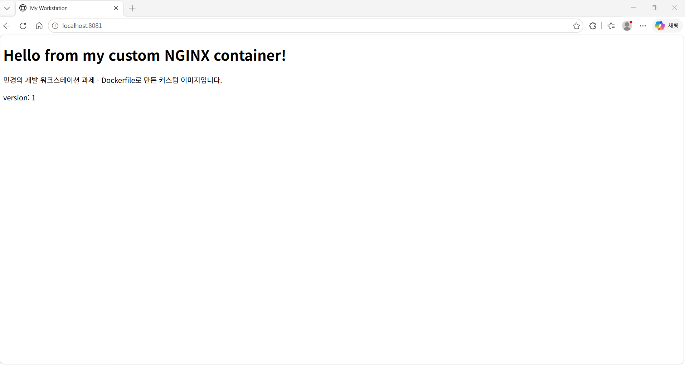
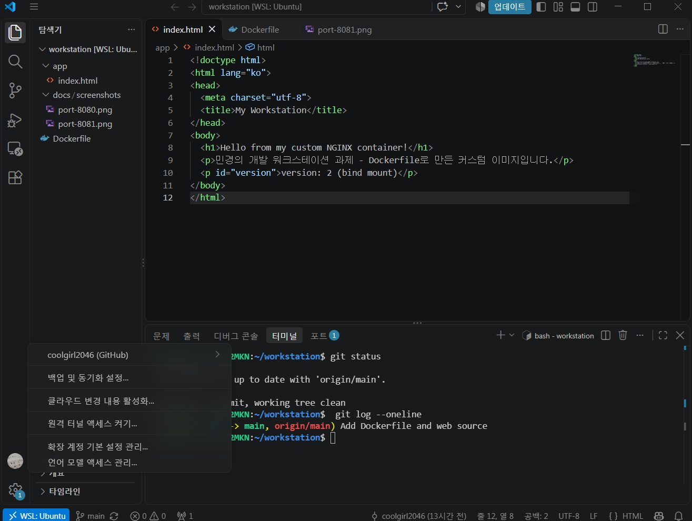
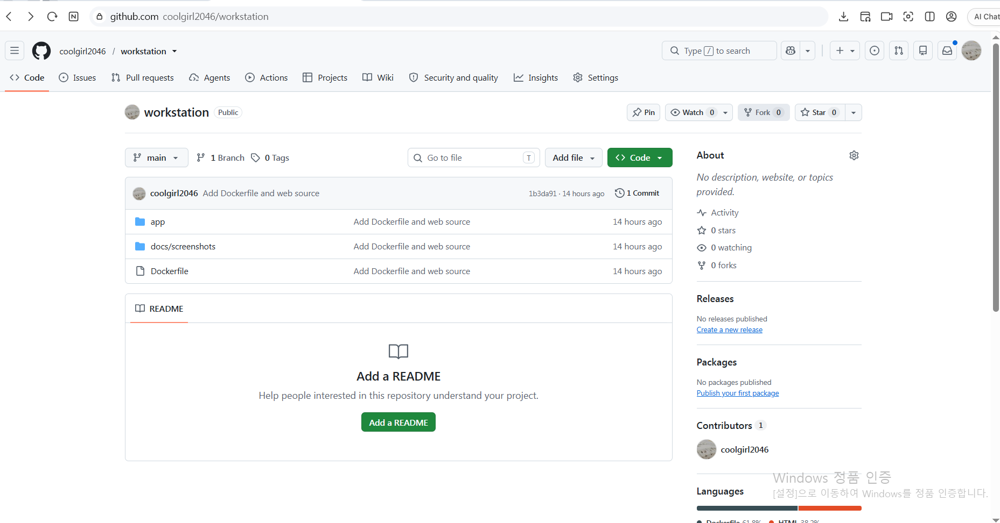

# 개발 워크스테이션 구축 (터미널 · Docker · Git)

Windows 10 PC에 **WSL2(Ubuntu) + Docker Desktop + Git/GitHub** 기반 개발 환경을 직접 구성하고,
터미널 조작 → 권한 → Docker 운영 → Dockerfile 커스텀 이미지 → 포트 매핑 → 바인드 마운트 → 볼륨 → Git/GitHub 연동까지
**실행 결과(로그·접속·데이터 유지)로 검증**한 기록입니다.

> 서울캠퍼스 안내는 macOS + OrbStack 기준이지만, 이 과제는 **개인 Windows PC**에서 수행했습니다.
> OrbStack은 macOS/Linux용이므로 **WSL2 + Docker Desktop(WSL2 백엔드)**으로 대체했으며, `docker` 명령 사용법은 동일합니다.

---

## 1. 프로젝트 개요

| 목표 | 수행 내용 |
|---|---|
| 터미널 | 경로 이동, 숨김 파일 목록, 생성·복사·이동·이름변경·삭제, 내용 확인 |
| 권한 | 파일·디렉토리 권한 변경 전/후 비교 (644↔600, 755↔700) |
| Docker | 설치 점검, 이미지/컨테이너 운영, 로그·리소스 확인, attach/exec 차이 관찰 |
| Dockerfile | `nginx:alpine` 기반 커스텀 이미지 제작 (LABEL·ENV·COPY·HEALTHCHECK) |
| 포트 매핑 | 같은 이미지를 8080/8081 두 포트로 실행, 브라우저·curl 접속 |
| 스토리지 | 바인드 마운트 변경 반영, Docker 볼륨 영속성 검증 |
| Git/GitHub | 사용자·기본 브랜치 설정, 커밋, GitHub push, VSCode 연동 |

## 2. 실행 환경

| 항목 | 값 |
|---|---|
| OS | Windows 10 (10.0.19045) + WSL2 Ubuntu |
| WSL | 3.0.3.0 (커널 6.18.54.1-1) |
| Shell | bash |
| Terminal | Ubuntu(WSL) 터미널, VSCode 통합 터미널(WSL: Ubuntu) |
| CPU 아키텍처 | x86_64 (amd64) |
| Docker | Docker Desktop 4.97.0 / Docker Engine 29.9.2 |
| Git | 2.53.0 |
| 에디터 | VSCode + WSL 확장 |

```bash
PS C:\Users\pc> wsl --version
WSL 버전: 3.0.3.0
커널 버전: 6.18.54.1-1
...
Windows 버전: 10.0.19045.6466

pc@DESKTOP-4DK2MKN:~$ uname -m
x86_64
pc@DESKTOP-4DK2MKN:~$ git --version
git version 2.53.0
pc@DESKTOP-4DK2MKN:~$ docker --version
Docker version 29.9.2, build a82e528
```

## 3. 수행 체크리스트

- [x] 터미널 기본 조작 및 폴더 구성
- [x] 권한 변경 실습 (파일 1개, 디렉토리 1개)
- [x] Docker 설치/점검 (`docker --version`, `docker info`)
- [x] Docker 기본 운영 명령 (images / ps / logs / stats / stop)
- [x] hello-world 실행
- [x] ubuntu 컨테이너 진입 및 attach/exec 차이 관찰
- [x] Dockerfile 커스텀 이미지 빌드/실행
- [x] 포트 매핑 접속 (8080, 8081)
- [x] 바인드 마운트 변경 반영
- [x] Docker 볼륨 영속성
- [x] Git 설정 + GitHub push + VSCode 연동

## 4. 저장소 구조

```
.
├── README.md                 # 기술 문서 (이 파일)
├── Dockerfile                # 커스텀 이미지 정의
├── app/
│   └── index.html            # 웹 서버 정적 소스
└── docs/
    └── screenshots/          # 브라우저 접속, VSCode/GitHub 연동 캡처
```

## 5. 검증 방법 요약

| 항목 | 확인 명령 | 기대 결과 | 증거 위치 |
|---|---|---|---|
| Docker 동작 | `docker info` | Server 정보 출력 | [8장](#8-docker-설치-및-점검) |
| 커스텀 이미지 | `docker build`, `docker inspect` | LABEL/ENV 반영 | [10장](#10-dockerfile-커스텀-이미지) |
| 포트 매핑 | `curl localhost:8080/8081`, 브라우저 | 내 페이지 응답 | [11장](#11-포트-매핑-접속-증거), `docs/screenshots/port-*.png` |
| 바인드 마운트 | 호스트 파일 수정 후 `curl` | 8082만 변경 반영 | [12장](#12-바인드-마운트-변경-반영) |
| 볼륨 영속성 | 컨테이너 삭제 후 새 컨테이너에서 `cat` | 데이터 유지 | [13장](#13-docker-볼륨-영속성) |
| Git/GitHub | `git config --list`, `git push` | 설정·업로드 완료 | [14장](#14-git-설정-및-github-연동) |

---

## 6. 터미널 조작 로그

### 현재 위치·사용자 확인, 숨김 파일 포함 목록
```bash
pc@DESKTOP-4DK2MKN:~$ pwd
/home/pc
pc@DESKTOP-4DK2MKN:~$ whoami
pc
pc@DESKTOP-4DK2MKN:~/practice$ ls -la ~
total 40
drwxr-x--- 6 pc   pc   4096 Nov  2 12:14 .
drwxr-xr-x 3 root root 4096 Nov  2 11:23 ..
lrwxrwxrwx 1 pc   pc     20 Nov  2 12:06 .aws -> /mnt/c/Users/pc/.aws
lrwxrwxrwx 1 pc   pc     22 Nov  2 12:06 .azure -> /mnt/c/Users/pc/.azure
-rw------- 1 pc   pc     95 Nov  2 12:09 .bash_history
-rw-r--r-- 1 pc   pc    220 Nov  2 11:23 .bash_logout
-rw-r--r-- 1 pc   pc   3771 Nov  2 11:23 .bashrc
drwxr-x--- 4 pc   pc   4096 Nov  2 11:28 .cache
drwxr-x--- 3 pc   pc   4096 Nov  2 11:28 .config
drwxr-xr-x 4 pc   pc   4096 Nov  2 12:06 .docker
-rw-rw-r-- 1 pc   pc      0 Nov  2 11:28 .motd_shown
-rw-r--r-- 1 pc   pc    807 Nov  2 11:23 .profile
drwxr-xr-x 3 pc   pc   4096 Nov  2 12:14 practice
```

### 생성 · 빈 파일 · 내용 확인
```bash
pc@DESKTOP-4DK2MKN:~$ mkdir -p ~/practice/docs
pc@DESKTOP-4DK2MKN:~$ cd practice
pc@DESKTOP-4DK2MKN:~/practice$ touch empty,txt
pc@DESKTOP-4DK2MKN:~/practice$ echo "hello workstation" > hello.txt
pc@DESKTOP-4DK2MKN:~/practice$ cat hello.txt
hello workstation
pc@DESKTOP-4DK2MKN:~/practice$ ls -la
total 16
drwxr-xr-x 3 pc pc 4096 Nov  2 12:16 .
drwxr-x--- 6 pc pc 4096 Nov  2 12:14 ..
drwxr-xr-x 2 pc pc 4096 Nov  2 12:14 docs
-rw-r--r-- 1 pc pc    0 Nov  2 12:16 empty,txt
-rw-r--r-- 1 pc pc   18 Nov  2 12:16 hello.txt
```
> `touch empty,txt`는 점(.) 대신 쉼표(,)를 입력한 오타였고, 다음 단계에서 `mv`로 이름을 바로잡았다.

### 이름 변경 · 복사 · 이동 · 삭제
```bash
pc@DESKTOP-4DK2MKN:~/practice$ mv empty,txt empty.txt
pc@DESKTOP-4DK2MKN:~/practice$ cp hello.txt docs/hello_copy.txt
pc@DESKTOP-4DK2MKN:~/practice$ mv empty.txt docs/
pc@DESKTOP-4DK2MKN:~/practice$ ls -la docs
total 12
drwxr-xr-x 2 pc pc 4096 Nov  2 12:52 .
drwxr-xr-x 3 pc pc 4096 Nov  2 12:52 ..
-rw-r--r-- 1 pc pc    0 Nov  2 12:16 empty.txt
-rw-r--r-- 1 pc pc   18 Nov  2 12:52 hello_copy.txt
pc@DESKTOP-4DK2MKN:~/practice$ rm docs/empty.txt
pc@DESKTOP-4DK2MKN:~/practice$ ls -la docs
total 12
drwxr-xr-x 2 pc pc 4096 Nov  2 12:53 .
drwxr-xr-x 3 pc pc 4096 Nov  2 12:52 ..
-rw-r--r-- 1 pc pc   18 Nov  2 12:52 hello_copy.txt
```

### 절대 경로 vs 상대 경로
```bash
pc@DESKTOP-4DK2MKN:~/practice$ cd /home/pc/practice/docs    # 절대 경로
pc@DESKTOP-4DK2MKN:~/practice/docs$ pwd
/home/pc/practice/docs
pc@DESKTOP-4DK2MKN:~/practice/docs$ cd ../..                # 상대 경로 (두 단계 위)
pc@DESKTOP-4DK2MKN:~$ pwd
/home/pc
```
- **절대 경로**: 최상위 `/`부터 시작하는 전체 주소. 어디서 실행해도 같은 곳을 가리킨다. 예: `/home/pc/practice/docs`
- **상대 경로**: 현재 위치(`pwd`) 기준 주소. `..`은 한 단계 위, `.`은 현재 위치. 예: `cd practice`, `cd ../..`
- `~`는 홈 디렉토리(`/home/pc`)의 줄임 표기다.

## 7. 권한 실습

```bash
# 변경 전 (ls -la 결과 발췌)
drwxr-xr-x 2 pc pc 4096 Nov  2 12:14 docs        # 755
-rw-r--r-- 1 pc pc   18 Nov  2 12:16 hello.txt   # 644

pc@DESKTOP-4DK2MKN:~/practice$ chmod 600 hello.txt
pc@DESKTOP-4DK2MKN:~/practice$ chmod 70 docs           # 700 입력 중 0 누락 (트러블슈팅 3 참고)
pc@DESKTOP-4DK2MKN:~/practice$ stat -c '%a %A %n' hello.txt docs
600 -rw------- hello.txt
70 d---rwx--- docs
pc@DESKTOP-4DK2MKN:~/practice$ ls docs
ls: cannot open directory 'docs': Permission denied
pc@DESKTOP-4DK2MKN:~/practice$ chmod 700 docs
pc@DESKTOP-4DK2MKN:~/practice$ ls docs
hello_copy.txt

# 원래 권한으로 복구
pc@DESKTOP-4DK2MKN:~/practice$ chmod 755 docs
pc@DESKTOP-4DK2MKN:~/practice$ chmod 644 hello.txt
pc@DESKTOP-4DK2MKN:~/practice$ stat -c '%a %A %n' hello.txt docs
644 -rw-r--r-- hello.txt
755 drwxr-xr-x docs
```

| 대상 | 변경 전 | 변경 후 | 복구 |
|---|---|---|---|
| hello.txt (파일) | 644 `rw-r--r--` | 600 `rw-------` | 644 |
| docs (디렉토리) | 755 `rwxr-xr-x` | 070 → 700 `rwx------` | 755 |

**r/w/x와 숫자 표기**
- `r`=읽기(4), `w`=쓰기(2), `x`=실행(1). 세 자리는 **소유자 / 그룹 / 기타 사용자** 순서이며 각 자리는 합으로 표현한다.
- `755` = `rwx r-x r-x` → 소유자는 모두, 나머지는 읽기·실행만 (디렉토리·스크립트에 흔함)
- `644` = `rw- r-- r--` → 소유자는 읽기·쓰기, 나머지는 읽기만 (일반 파일 기본값)
- 디렉토리의 `x`는 **안으로 들어가 내용을 볼 수 있는 권한**이다. 소유자 `x`가 없던 070 상태에서 `ls docs`가 거부된 것으로 확인했다.

## 8. Docker 설치 및 점검

```bash
pc@DESKTOP-4DK2MKN:~$ docker --version
Docker version 29.9.2, build a82e528

pc@DESKTOP-4DK2MKN:~$ docker info      # 발췌
Client:
 Version:    29.9.2
 Context:    default
 ...
Server:
 Containers: 0
  Running: 0
  Paused: 0
  Stopped: 0
 Images: 0
 Server Version: 29.9.2
 Storage Driver: overlayfs
 ...
 Kernel Version: 6.18.54.1-microsoft-standard-WSL2
 Operating System: Docker Desktop
 OSType: linux
 Architecture: x86_64
 CPUs: 8
 Total Memory: 1.8GiB
 Name: docker-desktop
```
`Server:` 항목이 출력되므로 Docker 데몬(엔진)이 정상 동작 중이다.

## 9. Docker 기본 운영 명령

### hello-world
```bash
pc@DESKTOP-4DK2MKN:~/practice$ docker run hello-world
Unable to find image 'hello-world:latest' locally
latest: Pulling from library/hello-world
4f55086f7dd0: Pull complete
d5e71e642bf5: Download complete
Digest: sha256:c567b231f65614688711a75f31518a064258a51d442117a3e771a3a8fdba78ef
Status: Downloaded newer image for hello-world:latest

Hello from Docker!
This message shows that your installation appears to be working correctly.
...
```

### 이미지·컨테이너 목록
```bash
pc@DESKTOP-4DK2MKN:~/practice$ docker images
IMAGE                ID             DISK USAGE   CONTENT SIZE   EXTRA
hello-world:latest   c567b231f656       25.9kB         9.49kB    U
pc@DESKTOP-4DK2MKN:~/practice$ docker ps
CONTAINER ID   IMAGE     COMMAND   CREATED   STATUS    PORTS     NAMES
pc@DESKTOP-4DK2MKN:~/practice$ docker ps -a
CONTAINER ID   IMAGE         COMMAND    CREATED              STATUS                          PORTS     NAMES
9d0be3b878c9   hello-world   "/hello"   About a minute ago   Exited (0) About a minute ago             beautiful_kowalevski
```
- `docker ps`는 실행 중인 컨테이너만, `docker ps -a`는 종료된 것까지 보여준다.

### ubuntu 컨테이너 진입
```bash
pc@DESKTOP-4DK2MKN:~/practice$ docker run -it --name my-ubuntu ubuntu bash
Unable to find image 'ubuntu:latest' locally
...
Status: Downloaded newer image for ubuntu:latest
root@51a43b7fccfe:/# ls
bin  boot  dev  etc  home  lib  lib64  media  mnt  opt  proc  root  run  sbin  srv  sys  tmp  usr  var
root@51a43b7fccfe:/# echo "hello from container"
hello from container
root@51a43b7fccfe:/# cat /etc/os-release
PRETTY_NAME="Ubuntu 26.04.1 LTS"
...
root@51a43b7fccfe:/# exit
pc@DESKTOP-4DK2MKN:~/practice$ docker ps -a
CONTAINER ID   IMAGE         COMMAND    CREATED         STATUS                     PORTS     NAMES
51a43b7fccfe   ubuntu        "bash"     3 minutes ago   Exited (0) 8 seconds ago             my-ubuntu
9d0be3b878c9   hello-world   "/hello"   5 minutes ago   Exited (0) 5 minutes ago             beautiful_kowalevski
```

### attach vs exec 관찰
```bash
pc@DESKTOP-4DK2MKN:~/practice$ docker start my-ubuntu
my-ubuntu
pc@DESKTOP-4DK2MKN:~/practice$ docker exec -it my-ubuntu bash
root@51a43b7fccfe:/# exit
pc@DESKTOP-4DK2MKN:~/practice$ docker ps
CONTAINER ID   IMAGE     COMMAND   CREATED          STATUS              PORTS     NAMES
51a43b7fccfe   ubuntu    "bash"    11 minutes ago   Up About a minute             my-ubuntu     # exec 종료 후에도 실행 유지

pc@DESKTOP-4DK2MKN:~/practice$ docker attach my-ubuntu
root@51a43b7fccfe:/# exit
pc@DESKTOP-4DK2MKN:~/practice$ docker ps
CONTAINER ID   IMAGE     COMMAND   CREATED   STATUS    PORTS     NAMES
pc@DESKTOP-4DK2MKN:~/practice$ docker ps -a
CONTAINER ID   IMAGE         COMMAND    CREATED          STATUS                      PORTS     NAMES
51a43b7fccfe   ubuntu        "bash"     11 minutes ago   Exited (0) 10 seconds ago             my-ubuntu     # attach 종료 시 컨테이너도 종료
```

| 방법 | 연결 대상 | exit 후 컨테이너 |
|---|---|---|
| `docker attach` | 컨테이너의 메인 프로세스(처음 실행한 bash) | **종료**(Exited) |
| `docker exec -it ... bash` | 새로 띄운 별도 bash 프로세스 | **계속 실행**(Up) |

> 컨테이너는 메인 프로세스가 끝나면 함께 종료된다. attach는 메인 bash에 붙으므로 exit 시 컨테이너가 멈추고,
> exec는 별도 프로세스를 추가하므로 exit 해도 유지된다. 실행 중인 서비스를 점검할 때는 exec가 안전하다.

### 로그 · 리소스 · 중지
```bash
pc@DESKTOP-4DK2MKN:~/practice$ docker logs my-ubuntu     # 발췌
root@51a43b7fccfe:/# ls
bin  boot  dev  etc  home  lib  lib64  media  mnt  opt  proc  root  run  sbin  srv  sys  tmp  usr  var
root@51a43b7fccfe:/# echo "hello from container"
hello from container
...
root@51a43b7fccfe:/# exit
exit
root@51a43b7fccfe:/# exit
exit
```
> 로그에는 메인 bash에서 입력한 내용만 남는다. `exit`가 두 번인 것은 최초 `run`과 `attach` 세션이고, exec 세션은 별도 프로세스라 기록되지 않았다.

```bash
pc@DESKTOP-4DK2MKN:~/practice$ docker start my-ubuntu
my-ubuntu
pc@DESKTOP-4DK2MKN:~/practice$ docker stats --no-stream
CONTAINER ID   NAME        CPU %     MEM USAGE / LIMIT   MEM %     NET I/O         BLOCK I/O     PIDS
51a43b7fccfe   my-ubuntu   0.00%     3.121MiB / 1.8GiB   0.17%     1.17kB / 126B   16.8MB / 0B   1
pc@DESKTOP-4DK2MKN:~/practice$ docker stop my-ubuntu
my-ubuntu
pc@DESKTOP-4DK2MKN:~/practice$ docker ps -a
CONTAINER ID   IMAGE         COMMAND    CREATED          STATUS                       PORTS     NAMES
51a43b7fccfe   ubuntu        "bash"     26 minutes ago   Exited (137) 8 seconds ago             my-ubuntu
9d0be3b878c9   hello-world   "/hello"   28 minutes ago   Exited (0) 28 minutes ago              beautiful_kowalevski
```
> `Exited (137)` = 128 + 9(SIGKILL). `docker stop`은 먼저 종료 요청(SIGTERM)을 보내고 10초 안에 끝나지 않으면 강제 종료한다. PID 1인 bash가 SIGTERM을 무시해 강제 종료되었다.

## 10. Dockerfile 커스텀 이미지

- **선택한 베이스**: `nginx:alpine` — 방식 (A) 웹 서버 베이스 이미지 + 정적 콘텐츠/설정 교체

```dockerfile
# 베이스: 공식 NGINX 웹 서버(alpine 리눅스 기반이라 작음)
FROM nginx:alpine

# 커스텀 1: 이미지 이름표(메타데이터)
LABEL org.opencontainers.image.title="my-workstation-web"

# 커스텀 2: 환경 변수
ENV APP_ENV=dev

# 커스텀 3: 기본 환영 페이지를 내 페이지로 교체
COPY app/ /usr/share/nginx/html/

# 커스텀 4: 30초마다 웹 서버가 응답하는지 자가 점검
HEALTHCHECK --interval=30s --timeout=3s \
  CMD wget -q -O /dev/null http://localhost/ || exit 1

EXPOSE 80
```

| 커스텀 포인트 | 목적 |
|---|---|
| `LABEL` | 이미지 이름·설명 메타데이터 기록 (`docker inspect`로 확인) |
| `ENV APP_ENV=dev` | 실행 환경 구분용 환경 변수 주입 (설정과 코드 분리) |
| `COPY app/ ...` | NGINX 기본 페이지를 직접 작성한 정적 페이지로 교체 |
| `HEALTHCHECK` | 컨테이너가 실제로 응답하는지 주기적으로 점검 (`docker ps`에 healthy 표시) |

```bash
pc@DESKTOP-4DK2MKN:~/workstation$ docker build -t my-web:1.0 .
[+] Building 109.8s (7/7) FINISHED                                 docker:default
 => [internal] load build definition from Dockerfile                         0.6s
 => [internal] load metadata for docker.io/library/nginx:alpine             11.7s
 => [1/2] FROM docker.io/library/nginx:alpine@sha256:785835ea65db4bba6f021  65.9s
 ...
 => [2/2] COPY app/ /usr/share/nginx/html/                                   1.1s
 => exporting to image                                                      20.1s
 => => naming to docker.io/library/my-web:1.0                                1.4s

pc@DESKTOP-4DK2MKN:~/workstation$ docker images
IMAGE                ID             DISK USAGE   CONTENT SIZE   EXTRA
hello-world:latest   c567b231f656       25.9kB         9.49kB    U
my-web:1.0           5068b6c124ad       93.6MB         26.3MB
ubuntu:latest        6a06111c3b0a        163MB         45.9MB    U

pc@DESKTOP-4DK2MKN:~/workstation$ docker inspect my-web-8080 --format '{{.Config.Labels}} {{.Config.Env}}'
map[desktop.docker.io/wsl-distro:Ubuntu maintainer:NGINX Docker Maintainers <docker-maint@nginx.com> org.opencontainers.image.title:my-workstation-web] [PATH=/usr/local/sbin:/usr/local/bin:/usr/sbin:/usr/bin:/sbin:/bin NGINX_VERSION=1.31.8 PKG_RELEASE=1 DYNPKG_RELEASE=1 NJS_VERSION=1.0.2 NJS_RELEASE=1 ACME_VERSION=0.4.1 APP_ENV=dev]
```
> 빌드 단계가 `[1/2] FROM`, `[2/2] COPY` 두 개뿐인 이유: LABEL·ENV·HEALTHCHECK·EXPOSE는 파일시스템 레이어가 아니라 이미지 설정(메타데이터)이기 때문이다. `inspect` 결과에서 직접 추가한 `my-workstation-web`, `APP_ENV=dev`와 베이스에서 물려받은 `maintainer`, `NGINX_VERSION`이 함께 보인다.

## 11. 포트 매핑 접속 증거

```bash
pc@DESKTOP-4DK2MKN:~/workstation$ docker run -d -p 8080:80 --name my-web-8080 my-web:1.0
a60bb64eeec17fc76429e9a63ab73db5ad434ecc017ddbe17036ad53db514ead
pc@DESKTOP-4DK2MKN:~/workstation$ docker run -d -p 8081:80 --name my-web-8081 my-web:1.0
9c0c6d1986f363c93e1fc7f3f71c881bea8c1033d4df7292e650329546e8eaed
pc@DESKTOP-4DK2MKN:~/workstation$ docker ps
CONTAINER ID   IMAGE        COMMAND                  CREATED          STATUS                    PORTS                                     NAMES
9c0c6d1986f3   my-web:1.0   "/docker-entrypoint.…"   46 minutes ago   Up 46 minutes (healthy)   0.0.0.0:8081->80/tcp, [::]:8081->80/tcp   my-web-8081
a60bb64eeec1   my-web:1.0   "/docker-entrypoint.…"   46 minutes ago   Up 46 minutes (healthy)   0.0.0.0:8080->80/tcp, [::]:8080->80/tcp   my-web-8080

pc@DESKTOP-4DK2MKN:~/workstation$ curl http://localhost:8080
<!doctype html>
...
  <h1>Hello from my custom NGINX container!</h1>
  <p>민경의 개발 워크스테이션 과제 - Dockerfile로 만든 커스텀 이미지입니다.</p>
  <p id="version">version: 1</p>
...
pc@DESKTOP-4DK2MKN:~/workstation$ curl http://localhost:8081
(8080과 동일한 응답)
```

**브라우저 접속 화면 (주소창 포트 포함)**




**포트 매핑이 필요한 이유**
컨테이너는 격리된 네트워크에서 실행되므로, 컨테이너 내부 80번 포트는 호스트에서 바로 접근할 수 없다.
`-p 8080:80`은 "호스트 8080번으로 들어온 요청을 컨테이너 80번으로 전달"하는 연결이다.
두 컨테이너가 내부에서 모두 80번을 써도 호스트 포트를 다르게(8080, 8081) 주면 동시에 실행할 수 있다.

## 12. 바인드 마운트 변경 반영

```bash
pc@DESKTOP-4DK2MKN:~/workstation$ docker run -d -p 8082:80 --name my-web-bind -v "$(pwd)/app":/usr/share/nginx/html my-web:1.0
e1bc320072894a9dc235fb0f8add9f6c0adf9e3df53fcadd5d642546569c8b29

# 변경 전
pc@DESKTOP-4DK2MKN:~/workstation$ curl http://localhost:8082
...
  <p id="version">version: 1</p>
...

# 호스트(내 PC)에서 파일 수정
pc@DESKTOP-4DK2MKN:~/workstation$ sed -i 's/version: 1/version: 2 (bind mount)/' app/index.html
pc@DESKTOP-4DK2MKN:~/workstation$ curl http://localhost:8082     # 컨테이너 재시작 없이 즉시 반영
...
  <p id="version">version: 2 (bind mount)mount)</p>
...
# 'mount)'가 중복 입력됨(붙여넣기 줄바꿈 영향으로 추정) → 호스트에서 다시 수정
pc@DESKTOP-4DK2MKN:~/workstation$ sed -i 's/mount)mount)/mount)/' app/index.html
pc@DESKTOP-4DK2MKN:~/workstation$ grep version app/index.html
  <p id="version">version: 2 (bind mount)</p>

# 변경 후 비교
pc@DESKTOP-4DK2MKN:~/workstation$ curl localhost:8082
...
  <p id="version">version: 2 (bind mount)</p>
...
pc@DESKTOP-4DK2MKN:~/workstation$ curl localhost:8080
...
  <p id="version">version: 1</p>
...
```

| 컨테이너 | 연결 방식 | 호스트 파일 수정 후 |
|---|---|---|
| my-web-bind (8082) | 바인드 마운트: 호스트 `app/` 폴더를 직접 연결 | **즉시 반영** (`version: 2`) |
| my-web-8080 (8080) | 빌드 시 이미지에 `COPY` | 변경 없음 (`version: 1`) |

## 13. Docker 볼륨 영속성

```bash
pc@DESKTOP-4DK2MKN:~/workstation$ docker volume create mydata
mydata
pc@DESKTOP-4DK2MKN:~/workstation$ docker volume ls
DRIVER    VOLUME NAME
local     mydata

# 컨테이너 1: 볼륨 연결 후 데이터 쓰기
pc@DESKTOP-4DK2MKN:~/workstation$ docker run -d --name voltest1 -v mydata:/data ubuntu sleep infinity
ae96e95b1ff49a214b9c8f4022003cd99eff0e208b14d109216d387b96be58e8
pc@DESKTOP-4DK2MKN:~/workstation$ docker exec voltest1 sh -c "echo hello-volume > /data/hello.txt"
pc@DESKTOP-4DK2MKN:~/workstation$ docker exec voltest1 cat /data/hello.txt
hello-volume

# 컨테이너 삭제
pc@DESKTOP-4DK2MKN:~/workstation$ docker rm -f voltest1
voltest1
pc@DESKTOP-4DK2MKN:~/workstation$ docker ps -a     # 발췌: voltest1 없음
...
a60bb64eeec1   my-web:1.0    "/docker-entrypoint.…"   2 hours ago  Up 2 hours (healthy)  0.0.0.0:8080->80/tcp, [::]:8080->80/tcp   my-web-8080
51a43b7fccfe   ubuntu        "bash"                   5 hours ago  Exited (137) 5 hours ago                                         my-ubuntu
9d0be3b878c9   hello-world   "/hello"                 5 hours ago  Exited (0) 5 hours ago                                           beautiful_kowalevski

# 컨테이너 2: 같은 볼륨 연결 후 데이터 확인
pc@DESKTOP-4DK2MKN:~/workstation$ docker run -d --name voltest2 -v mydata:/data ubuntu sleep infinity
d2b77108b86077f835e019d0eb6504218205367a2c58000bad15a55a51361f48
pc@DESKTOP-4DK2MKN:~/workstation$ docker exec voltest2 cat /data/hello.txt
hello-volume
```

**Docker 볼륨이란**
컨테이너 내부에 쓴 데이터는 컨테이너를 삭제하면 함께 사라진다. 볼륨은 Docker가 컨테이너와 **별도로 관리하는 저장 공간**이어서,
컨테이너를 지워도 남아 있고 새 컨테이너에 다시 연결할 수 있다. (바인드 마운트 = 호스트의 특정 경로 연결 / 볼륨 = Docker 관리 저장소 연결)

## 14. Git 설정 및 GitHub 연동

```bash
pc@DESKTOP-4DK2MKN:~/workstation$ git config --global user.name "coolgirl2046"
pc@DESKTOP-4DK2MKN:~/workstation$ git config --global user.email "300701823+coolgirl2046@users.noreply.github.com"
pc@DESKTOP-4DK2MKN:~/workstation$ git config --global init.defaultBranch main
pc@DESKTOP-4DK2MKN:~/workstation$ git config --list
user.email=300701823+coolgirl2046@users.noreply.github.com
user.name=coolgirl2046
init.defaultbranch=main
```
> 개인 이메일 노출을 막기 위해 GitHub가 제공하는 noreply 주소를 사용했다.

```bash
pc@DESKTOP-4DK2MKN:~/workstation$ git init
Initialized empty Git repository in /home/pc/workstation/.git/
pc@DESKTOP-4DK2MKN:~/workstation$ git add .
pc@DESKTOP-4DK2MKN:~/workstation$ git status
On branch main

No commits yet

Changes to be committed:
  (use "git rm --cached <file>..." to unstage)
        new file:   Dockerfile
        new file:   app/index.html
        new file:   docs/screenshots/port-8080.png
        new file:   docs/screenshots/port-8081.png

pc@DESKTOP-4DK2MKN:~/workstation$ git commit -m "Add Dockerfile and web source"
[main (root-commit) 1b3da91] Add Dockerfile and web source
 4 files changed, 29 insertions(+)
 create mode 100644 Dockerfile
 create mode 100644 app/index.html
 create mode 100644 docs/screenshots/port-8080.png
 create mode 100644 docs/screenshots/port-8081.png

pc@DESKTOP-4DK2MKN:~/workstation$ git remote add origin https://github.com/coolgirl2046/workstation.git
pc@DESKTOP-4DK2MKN:~/workstation$ git remote -v
origin  https://github.com/coolgirl2046/workstation.git (fetch)
origin  https://github.com/coolgirl2046/workstation.git (push)
pc@DESKTOP-4DK2MKN:~/workstation$ git push -u origin main
Enumerating objects: 9, done.
...
To https://github.com/coolgirl2046/workstation.git
 * [new branch]      main -> main
branch 'main' set up to track 'origin/main'.
```

**VSCode GitHub 로그인 및 저장소 연동**

VSCode(WSL: Ubuntu 원격 연결)에서 GitHub 계정으로 로그인했고, VSCode 통합 터미널의 `git push`는 VSCode의 GitHub 인증을 사용해 별도 비밀번호 입력 없이 완료되었다.




**Git과 GitHub의 차이**
- **Git**: 내 컴퓨터에서 파일 변경 이력을 기록·관리하는 **로컬 버전 관리 도구** (`init`, `add`, `commit`)
- **GitHub**: Git 저장소를 인터넷에 올려 공유·협업하는 **원격 플랫폼** (`remote`, `push`, 웹 화면, 권한 관리)

## 15. 트러블슈팅

### 1) WSL 설치 중 다운로드 실패 (Error 0x80d03805)
- **문제**: `wsl --install` 실행 중 `Error: 0x80d03805`와 함께 2%에서 설치 중단
- **원인 가설**: Microsoft Store/Windows 업데이트 경로를 통한 패키지 다운로드 실패
- **확인**: 가상 머신 플랫폼과 WSL 기능 활성화는 완료됐고, 배포판 다운로드 단계에서만 실패함
- **해결**: Store를 거치지 않고 직접 내려받는 옵션으로 재시도 → 성공
  ```
  PS> wsl --install --web-download
  ...
  Ubuntu이(가) 설치되었습니다.
  요청한 작업이 잘 실행되었습니다. 시스템을 다시 시작하면 변경 사항이 적용됩니다.
  ```

### 2) docker 명령 실행 시 소켓 권한 거부
- **문제**: Docker Desktop 설치 후 Ubuntu에서 `docker version` 실행 시
  `permission denied while trying to connect to the docker API at unix:///var/run/docker.sock`
- **원인 가설**: Docker Desktop의 WSL Integration을 켜기 **전에** 열어 둔 셸이라 새 권한/소켓 설정이 반영되지 않음
- **확인**: Client 정보는 출력되지만 Server 연결만 실패 → 클라이언트 설치는 정상, 데몬 연결 문제
- **해결**: Settings → Resources → WSL integration에서 Ubuntu 활성화 후, PowerShell에서 `wsl --shutdown` → Ubuntu 재실행 → `docker info`에 Server 정보 정상 출력

### 3) chmod 오타로 소유자 접근 불가
- **문제**: `chmod 700 docs`를 `chmod 70 docs`로 입력한 뒤 `ls docs`가 `Permission denied`
- **원인 가설**: 두 자리 숫자는 앞에 0이 붙어 `070`으로 해석됨 → 소유자 권한 `---`
- **확인**: `stat -c '%a %A %n' docs` → `70 d---rwx--- docs`
- **해결**: 소유자는 디렉토리 내부 접근 권한이 없어도 권한 변경은 가능하므로 `chmod 700 docs`로 복구 후 `755`로 원복

### 4) VSCode "게시 Branch" 진행 멈춤
- **문제**: VSCode 소스 제어의 `게시 Branch`(Publish Branch)에서 계정 선택 후 저장소 생성 단계가 진행되지 않음
- **원인 가설**: 브라우저 인증 콜백이 VSCode로 돌아오지 않아 게시 흐름이 중단된 것으로 추정 (정확한 원인은 미확인)
- **확인**: `git remote -v` 결과가 비어 있음 → 원격 저장소 미생성
- **대안**: GitHub 웹에서 빈 public 저장소를 만든 뒤 `git remote add origin ...` + `git push -u origin main`으로 직접 연결 → 성공

## 16. 재현 방법 (평가자용)

```bash
git clone https://github.com/coolgirl2046/workstation.git
cd workstation
docker build -t my-web:1.0 .
docker run -d -p 8080:80 --name my-web-8080 my-web:1.0
curl http://localhost:8080
```

**주의사항**
- 저장소의 `app/index.html`은 바인드 마운트 실습 후 상태(`version: 2 (bind mount)`)로 커밋되어 있다. 새로 빌드하면 이 내용이 응답된다.
- 8080 포트가 사용 중이면 `-p 8090:80`처럼 다른 호스트 포트를 사용한다.
- 바인드 마운트 명령의 `$(pwd)/app`은 저장소 루트에서 실행한다는 전제다.
- Windows에서는 WSL2 + Docker Desktop(WSL integration 활성화)이 필요하며, 작업 폴더는 `/mnt/c/...`가 아닌 WSL 홈(`~`) 아래에 두어야 `chmod`가 정상 반영된다.

## 17. 보안 메모
- 로그·스크린샷에 토큰, 비밀번호, 인증 코드가 포함되지 않았음을 확인했다.
- Git 커밋 이메일은 GitHub noreply 주소를 사용했다.
- GitHub 인증은 VSCode 로그인으로 처리했으며 토큰을 직접 다루거나 기록하지 않았다.
